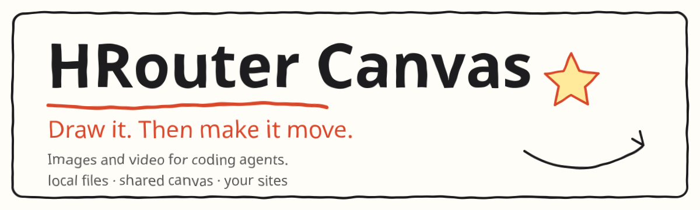

<div align="center">

<picture>
  <source media="(prefers-color-scheme: dark)" srcset="docs/assets/hero.svg">
  
</picture>

**An image and video plugin for coding agents.** When the agent cannot draw, it calls this plugin. Images and videos are saved as real files, and they show up on an infinite canvas you can drag, connect, and keep creating on.

[HRouter](https://hrouter.net) · [Image and video docs](https://hrouter.net/docs/image-video/) · [image.hrouter.net](https://image.hrouter.net)

**[Quick start](#-quick-start) · [Features](#-features) · [Docs](#-docs) · [License](#-license)**

**English** · [简体中文](README.zh-CN.md)

</div>

## ❤️ Sponsor

| Sponsor | What it is |
| :--- | :--- |
| [](https://hrouter.net/home) | **[HRouter](https://hrouter.net/home)**: model access, API key management, and usage tracking for AI coding and application development. Also operated by the maintainer. |

## 🚀 Quick start

Node.js 20.3 or newer.

### Claude Code

```bash
claude plugin marketplace add honestTai/hrouter-canvas
```

```bash
claude plugin install hrouter-canvas@hrouter
```

The plugin includes the MCP server, the skill, and the `/canvas` command.

### Codex

```bash
codex mcp add hrouter-canvas -- npx -y hrouter-canvas-mcp@latest
```

### opencode

Add this to `opencode.json`:

```json
{
  "mcp": {
    "hrouter-canvas": {
      "type": "local",
      "command": ["npx", "-y", "hrouter-canvas-mcp@latest"],
      "enabled": true
    }
  }
}
```

### DeepSeek Harness (dsh)

Add this to the profile’s `cordis.yml`:

```yaml
- id: mcp-hrouter-canvas
  name: '@deepseek-ai/dsh-mcp-client'
  config:
    serverName: hrouter-canvas
    transport: stdio
    command: npx
    args: ['-y', 'hrouter-canvas-mcp@latest']
```

### Other MCP clients

Configure a stdio server. The command is `npx -y hrouter-canvas-mcp@latest`.

### Ask the agent to use it (optional)

The Claude Code plugin already includes the skill. Other agents can copy this repo’s `skills/image-canvas` directory to wherever they read skills, for example `~/.agents/skills/` for dsh.

> The Claude Code plugin manifest was checked with `claude plugin validate --strict`. The Codex, opencode, and dsh snippets follow each product’s docs and have not been verified one by one. Open an issue if something fails.

## ✨ Features

| Feature | How it works |
| :--- | :--- |
| Draw, then make it move | The agent generates an image on one site, then hands that image to another site for video. The agent drives both steps. Image sites and video sites are configured separately, each with its own key. |
| The canvas and the agent share the work | You select, grab a frame, and adjust on the canvas. Say “continue the video I selected,” and the agent can find that item, see the keyframes, and keep generating. |
| Mainstream agents | Claude Code, Codex, opencode, DeepSeek Harness, and any MCP client. |
| Your sites and keys | Images: any site compatible with OpenAI Images or the Gemini native protocol. Video defaults to HRouter, and also accepts sites compatible with OpenAI Videos. You can configure more than one. |
| Runs on your machine | The canvas, images, videos, and config stay on your computer. Besides the image and video sites you configure, it connects to no other server. |
| Updates on launch | Each time the agent starts, it pulls the latest version. |

## 📚 Docs

**Sites.** The first time you ask the agent to draw or make a video, if no site is ready, the canvas settings page opens. Each site needs an address, an API key, and a model. Settings are split into an image-site list and a video-site list, each with a default. An image can be made on site 1 and sent to site 2 for video; the agent does not have to name the site. Both lists include an [HRouter](https://hrouter.net) preset: images ship with `gpt-image-2` and `gemini-3.1-flash-image`; the “HRouter 视频” video preset ships with `grok-imagine-video-1.5` (default) and `grok-imagine-video`. HRouter keys are grouped by capability, and video needs a grok-group key (see the [HRouter image and video docs](https://hrouter.net/docs/image-video/)), so the two lists usually use different keys.

**Animated GIFs.** With `gpt-image-2.6-flare` or `gpt-image-2.6-sunburst` added as a model on a site that supports them, pass `animated: true` to `generate_image` (optional `frame_count` 2-16, `frame_duration_ms`) to get a GIF. Text-to-image only.

On a machine without a browser (SSH, a container, CI), set these in the agent’s MCP config: `HROUTER_CANVAS_BASE_URL`, `HROUTER_CANVAS_API_KEY`, `HROUTER_CANVAS_MODEL`, `HROUTER_CANVAS_PROTOCOL` (`auto` by default, `openai`, or `gemini`), `HROUTER_CANVAS_VIDEO_MODEL` (adds a video site and makes it the default), `HROUTER_CANVAS_VIDEO_BASE_URL` (defaults to `HROUTER_CANVAS_BASE_URL`), `HROUTER_CANVAS_VIDEO_API_KEY` (defaults to `HROUTER_CANVAS_API_KEY`), `HROUTER_CANVAS_VIDEO_PROTOCOL` (`auto` by default, `xai`, or `openai`), `HROUTER_CANVAS_OPEN` (`never` never opens a browser), `HROUTER_CANVAS_FFMPEG` (path used to read video keyframes; looked up on `PATH` by default; `off` uses only the canvas page), `HROUTER_CANVAS_PORT` (default 17861), `HROUTER_CANVAS_HOME` (default `~/.hrouter-canvas`).

On auto, models whose names start with `gemini-` use Gemini native and the rest use OpenAI Images. Video models whose names start with `sora-` use OpenAI Videos and the rest use HRouter / xAI.

**Use it.** Tell the agent things like “draw a 16:9 product-launch poster,” “make `assets/logo.png` a dark version and save it under `assets/`,” “open the canvas,” “draw a cabin in the snow, then make it move, slow push-in, 8 seconds,” “turn that poster into a 5-second video,” “continue the video I selected on the canvas and pull the camera back,” or “take the frame at 3 seconds, make it night, then make a video.”

Tools: `generate_image`, `generate_video`, `video_status`, `list_canvas`, `view_canvas_item`, `extract_frame`, `open_canvas`, `list_image_models`.

You can also generate images and videos on the canvas itself (use “生成视频” on an image to take it as the first frame), grab a frame, continue from the end of a video, drop in images, set an image as a reference, connect, delete, and download. The canvas and the agent see the same items. Video keyframes come from ffmpeg when it is installed; otherwise the open canvas page decodes them in the browser, so there is nothing else to install.

```bash
npx hrouter-canvas-mcp open
```

Other subcommands: `url` (print the address with its access token), `status`, `stop`. A video usually takes 1 to 5 minutes. Codex interrupts tool calls at 60 seconds by default. Under `[mcp_servers.hrouter-canvas]` in `~/.codex/config.toml` you can add `tool_timeout_sec = 900`. Without that, the result is not lost: the video still finishes on the canvas, and the agent can read the path with `video_status`.

**Data and safety.** Images and videos are files under `~/.hrouter-canvas/boards/`. Deleting an item on the canvas deletes that file; a copy made with `save_to` is left alone. Keys stay in `~/.hrouter-canvas/config.json` at mode 0600. The page and the agent cannot read a key back, and no tool accepts a site address or a key. The server listens only on `127.0.0.1`. The page needs a local access token, and the server checks Host and Origin, so another website cannot operate it through your browser. After a request is sent, the result is still saved if you close the page or cancel the agent call. Image URLs must be https (or same-origin with the site) and a size-limited PNG, JPEG, or WebP. Videos must be MP4, up to 256 MB. Generation can cost money at the site you configure. HRouter video is billed per second when the job is seen to finish; failed or expired jobs are not billed.

**Updates.** Every install starts through `npx -y hrouter-canvas-mcp@latest`, so the next agent launch picks up a release. When the background canvas service sees a version change it restarts, and an open canvas page refreshes. Pin a version by replacing `@latest`. Update the Claude Code plugin shell with `claude plugin update hrouter-canvas@hrouter`.

**Local development.**

```bash
pnpm install
```

```bash
pnpm check
```

`pnpm check` typechecks, builds, and runs tests. Tests use a local fake site: they do not call a real service, spend money, or open a browser. When ffmpeg is installed, the suite also tests reading frames with ffmpeg; otherwise that part is skipped.

Connect a local build to Claude Code:

```bash
claude mcp add hrouter-canvas -- node /绝对路径/hrouter-canvas/dist/cli.mjs
```

Release: change the version in `package.json` and `.claude-plugin/plugin.json`, push a `v版本号` tag, and GitHub Actions publishes to npm (repository secret `NPM_TOKEN`).

**image.hrouter.net.** [image.hrouter.net](https://image.hrouter.net) is HRouter’s online canvas and signs in with an HRouter account. This project is a separate local version. It does not depend on the online service, and the two do not share works.

## 📄 License

[MIT](LICENSE). Third-party components are listed in [THIRD_PARTY_NOTICES.md](THIRD_PARTY_NOTICES.md).

## 📈 Star history

<a href="https://www.star-history.com/#honestTai/hrouter-canvas&Date">
  <picture>
    <source media="(prefers-color-scheme: dark)" srcset="https://api.star-history.com/svg?repos=honestTai/hrouter-canvas&type=Date&theme=dark">
    
  </picture>
</a>

<sub>Chart by star-history.com.</sub>

---

<div align="center">

Made by **[honestTai](https://github.com/honestTai)** · [HRouter](https://hrouter.net/home) · [More projects](https://github.com/honestTai)

</div>
